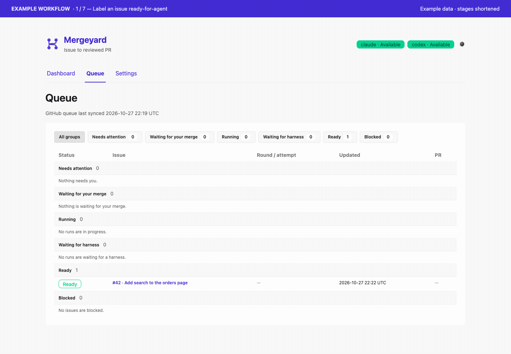
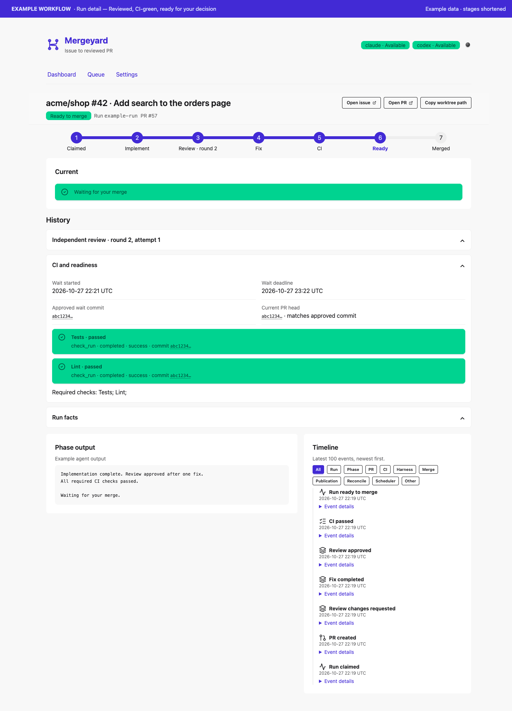
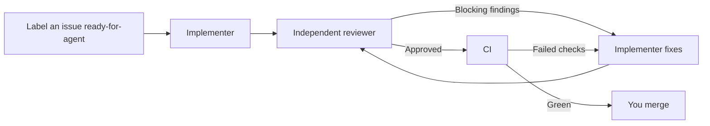

# Mergeyard

Label a GitHub issue `ready-for-agent` and let Mergeyard turn it into a reviewed,
CI-green pull request. It runs Claude Code or Codex on your machine, gives each
issue an isolated worktree, and coordinates implementation, independent review,
and fixes. Follow progress in the local dashboard. You decide what merges.

## See it in action



*Example data in the real dashboard, with time between stages shortened.*



## Install

After the first release is published, install on macOS or Linux with:

```sh
curl -fsSL https://github.com/rcpassos/mergeyard/releases/latest/download/install.sh | sh
```

Until then, [build from source](docs/install.md#build-from-source). Binaries
include the dashboard. See [installation](docs/install.md) for PATH setup,
checksums, upgrades, and version selection.

## Quickstart

Have Git, [GitHub CLI](https://cli.github.com/), tmux, and your chosen agents
installed and authenticated. Setup checks dependencies and helps configure
Claude Code or Codex independently for the implementer and reviewer.

```sh
gh auth login
mergeyard init
# Choose owner/repo and accept creation of the queue labels when prompted.

gh issue edit 123 --repo owner/repo --add-label ready-for-agent
mergeyard start
```

Replace `owner/repo` and `123` with your repository and issue number. Init runs
checks; resolve any reported errors before starting. Start opens the local
dashboard and prints a single-use link. Follow the run to **Waiting for your
merge**, inspect its PR, and merge it yourself. See [setup](docs/setup.md) if
you need help getting started.

## How it works



Fix and review rounds are bounded. When a run needs help, use the dashboard to
stop it or take over the implementer's conversation. Work stays in its branch,
worktree, and draft PR. [Workflow details](docs/workflow.md).

## Permissions

**Agents run with your local permissions.** The default Claude configuration
uses `bypassPermissions` for unattended execution. Only queue issues and
repositories you trust, and review the
[permission settings](mergeyard.example.yaml) before starting.

## Documentation

- [Commands](docs/cli.md) and [dashboard](docs/web.md)
- [Configuration](docs/configuration.md) and [example config](mergeyard.example.yaml)
- [Usage limits and credits](docs/usage-limits.md)
- [Development](docs/development.md) and [website](docs/website.md)
- [Releases](docs/releases.md)
